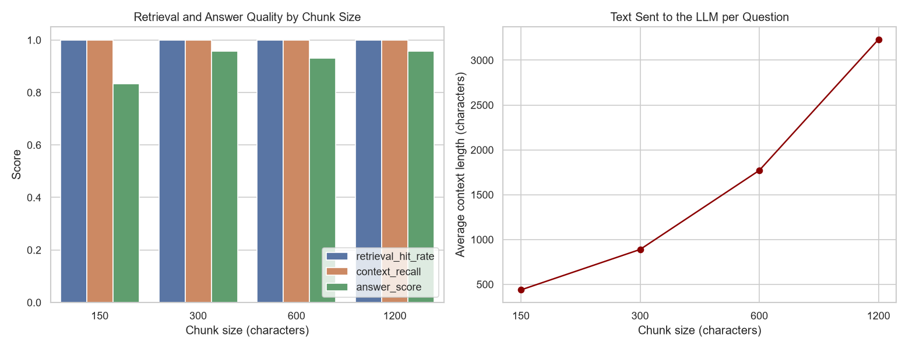
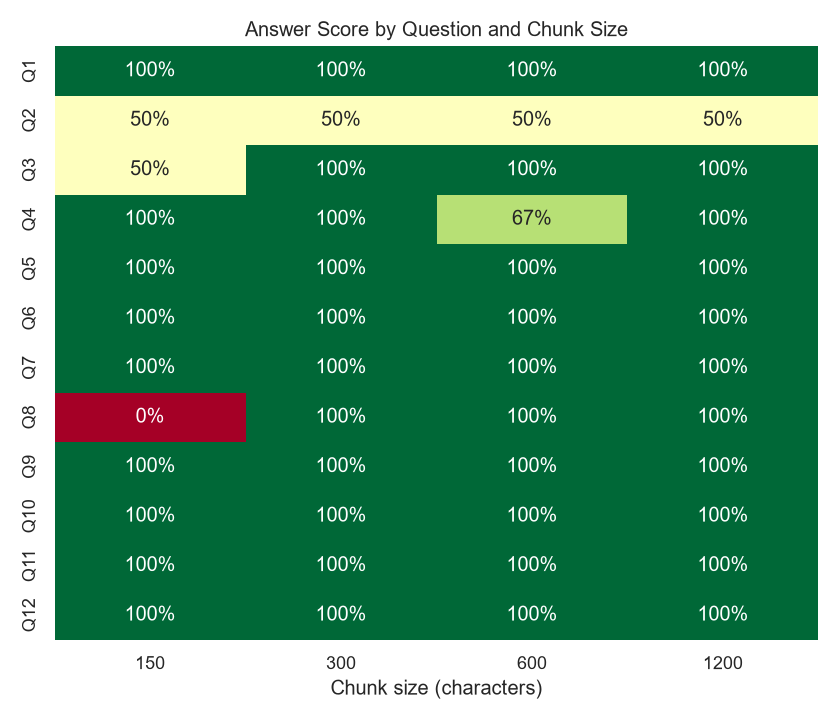

# RAG Chunk Size Comparison Report

## Goal
Find which document chunk size gives the best retrieval and answer quality in a basic RAG system built on company documentation.

## Setup
| Item | Value |
|---|---|
| Documents | 5 policy documents of a sample company, NovaTech Solutions (fictional): leave, remote work, IT security, expenses, onboarding; about 3,200–4,000 characters each |
| Chunking | word-based, 15% overlap between chunks |
| Chunk sizes tested | 150, 300, 600, 1200 characters |
| Embedding model | sentence-transformers/all-MiniLM-L6-v2 (384 dimensions) |
| Retrieval | cosine similarity, top 3 chunks |
| LLM | Qwen/Qwen2.5-0.5B-Instruct, greedy decoding, max 120 new tokens, run locally on CPU |
| Test set | 12 questions with known answers; 5 of them need two or three facts |

## Metrics
- **Retrieval hit:** at least one of the 3 retrieved chunks is from the correct document.
- **Context recall:** fraction of the key facts present in the retrieved text.
- **Answer score:** fraction of the key facts present in the generated answer.
- **Fully correct:** the answer contains all key facts.
- **Avg context / time:** characters sent to the LLM and seconds per answer.

## Results

| Chunk size | Chunks | Retrieval hit | Context recall | Answer score | Fully correct | Avg context | Avg time |
|---|---|---|---|---|---|---|---|
| 150 | 142 | 100% | 100% | 83% | 9 / 12 | 438 chars | 12.5 s |
| **300** | 72 | 100% | 100% | **96%** | **11 / 12** | 889 chars | 16.2 s |
| 600 | 37 | 100% | 100% | 93% | 10 / 12 | 1,771 chars | 24.7 s |
| 1200 | 19 | 100% | 100% | 96% | 11 / 12 | 3,232 chars | 39.0 s |

**1. Retrieval worked at every chunk size.** For all 12 questions and all 4 chunk sizes, the top 3 chunks came from the correct document and contained all the key facts. The documents are short and each covers a clearly different topic, so finding the right part was easy. This means the differences in answer quality came from **how well the LLM could use the retrieved text**, not from retrieval failing.

**2. 150 characters was clearly the worst (9/12).** Very small chunks cut sentences away from their subject:
- Q3 (paternity leave): the answer said "26 weeks", which is the *maternity* leave number. A tiny chunk had the maternity sentence and the start of the paternity sentence together, and the model mixed them up.
- Q8 (stolen laptop): the "within 1 hour" fact was retrieved, but the model answered from another fragment about the police report (24 hours) and missed the actual answer.

With small chunks, the model gets disconnected pieces without the section heading or the full sentence, so it's easier to confuse similar facts.

**3. 300 and 1200 tied for the best answers (11/12), but 300 is much cheaper.** 1200-character chunks send about 3.6x more text to the LLM (3,232 vs 889 characters) and take 2.4x longer (39 s vs 16 s per question) for the same score. With `top_k = 3`, three 1200-character chunks are almost a whole document, so at that size it's barely "retrieval" any more.

**4. 600 lost one point by chance, not because of retrieval.** In Q4, the context had both anchor days but the model only mentioned Thursday. This is a small-model slip; one question out of 12 is not a real difference between 300, 600 and 1200.

**5. One question failed at every chunk size.** Q2 asks two things (carry forward *and* encashment). Every chunk size retrieved both facts, but the model answered only the first part each time. This is a limit of the 0.5B model with two-part questions, so changing the chunk size doesn't fix it.

**6. The model made up an answer for a question not in the documents.** For "What is the policy on pets in the office?" it should have said it doesn't know, but it answered with unrelated text about locking laptops. Small models don't always follow the "say I don't know" instruction. A bigger LLM or a minimum similarity score for retrieved chunks would help.

### Best chunk size: 300 characters

300 characters (about 2–3 sentences, with 15% overlap) gave the joint-best answer quality with a small context and fast answers. It's big enough to keep a full sentence together with its subject, which fixed the mix-ups seen at 150, and small enough that the LLM isn't given a lot of unrelated text.

**Limitations:** only 12 test questions, 5 short documents and one run, and the scoring checks for key facts with string matching. With longer documents, or questions that need information from several sections, a bigger chunk size (around 500–600) might do better, so the experiment should be repeated on the real documents before choosing a chunk size.

## Charts

The full per-question answers are in `results/response_evaluation_table.csv` and in section 8 of the notebook.
